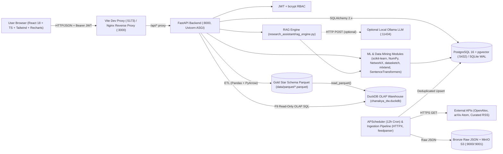

# Complete Technical Stack, Libraries, APIs & Architecture Audit
## Chanakya Research Commons — Data Mining & Warehousing (DMW) Project

**Audit Scope:** Full code-verified inventory of every programming language, direct & key transitive dependency, external API, database/warehouse engine, ML/data-mining/RAG algorithm, configuration variable, container, and inter-service communication flow actually present in the repository root (`<project-root>`).  
**Audience:** CSE (AI Engineering) project evaluation, technical viva, architecture presentation, and deep personal mastery.  
**Verification Policy:** Every library, version, endpoint, model, and file path below was verified directly against the source code, `backend/requirements.txt`, `frontend/package.json`, `frontend/package-lock.json`, live `.venv` (Python `3.14.7`), and live Docker container `chanakya-backend` (Python `3.12.16`). No secrets from `.env` are exposed.

---

## Table of Contents

1. [Executive System Overview](#1-executive-system-overview)
2. [Programming Languages & File Inventory](#2-programming-languages--file-inventory)
3. [Complete Library & Framework Inventory](#3-complete-library--framework-inventory)
   - [3A. Backend Web, ORM, Validation & Security Libraries](#3a-backend-web-orm-validation--security-libraries)
   - [3B. Machine Learning, NLP, Graph & Data Mining Libraries](#3b-machine-learning-nlp-graph--data-mining-libraries)
   - [3C. Data Engineering, Lakehouse & Data Warehousing Libraries](#3c-data-engineering-lakehouse--data-warehousing-libraries)
   - [3D. External Ingestion, Scheduling, Object Storage & Testing Libraries](#3d-external-ingestion-scheduling-object-storage--testing-libraries)
   - [3E. Frontend UI, Routing, Visualization & Build Libraries](#3e-frontend-ui-routing-visualization--build-libraries)
4. [External APIs, Protocols & Model Hubs](#4-external-apis-protocols--model-hubs)
5. [Complete Internal REST API Map (FastAPI)](#5-complete-internal-rest-api-map-fastapi)
6. [Databases, Lakehouse & Star Schema Data Warehouse](#6-databases-lakehouse--star-schema-data-warehouse)
7. [ML, Data Mining & RAG Algorithms Deep Dive](#7-ml-data-mining--rag-algorithms-deep-dive)
8. [System Architecture & Inter-Service Communication Flows](#8-system-architecture--inter-service-communication-flows)
9. [Environment Variables & Configuration Reference](#9-environment-variables--configuration-reference)
10. [Containerization, Networking & Deployment Stack](#10-containerization-networking--deployment-stack)
11. [CSE AI Engineering Viva Cheat-Sheet](#11-cse-ai-engineering-viva-cheat-sheet)

---

## 1. Executive System Overview

**Chanakya Research Commons** is a full-stack university research collaboration, data lakehouse, and intelligent discovery platform covering nine functional subsystems (**F1–F9**):

- **OLTP Application Layer:** React 18 + TypeScript + Tailwind CSS SPA communicating over REST/JSON (with JWT Bearer auth) to a FastAPI + SQLAlchemy 2.x backend backed by **PostgreSQL 16 (`pgvector`)** in Docker or **SQLite (WAL mode)** for zero-setup local development.
- **Data Lakehouse & OLAP Warehouse Layer:** Medallion architecture (**Bronze** raw JSON in `data/raw/` + optional **MinIO** S3 bucket → **Silver** deduplicated `papers_silver.parquet` + operational DB → **Gold** 9-table Kimball Star Schema in `data/parquet/*.parquet` materialized in **DuckDB** for sub-second institutional analytics and 4-level OLAP drill-down).
- **Data Mining, ML & RAG Intelligence Layer:** Dense semantic embeddings (`all-MiniLM-L6-v2` in Docker / `TF-IDF + TruncatedSVD` fallback locally), Hybrid RRF + Citation Graph PageRank search (`NetworkX`), Hybrid Content + Collaborative Filtering + `FP-Growth` association-rule recommendations (`mlxtend`), `MinHash LSH` + Author Entity Resolution deduplication (`datasketch`), `Isolation Forest` spam detection (`scikit-learn`), Non-Adjacent Outlier-Guarded Z-Score trend spike detection (`NumPy`), Agglomerative topic clustering, and a strict citation-grounded RAG assistant (local `Ollama` LLM with deterministic extractive fallback).

---

## 2. Programming Languages & File Inventory

Excluding generated directories (`.venv/`, `node_modules/`, `.tools/`, `dist/`, `__pycache__/`, `data/`), the project source tree uses **10 languages/configuration formats**:

| Language / Format | File Count | Where It Is Used | Key Files | Responsibilities |
|---|---:|---|---|---|
| **Python** (`.py`) | 27 | Backend API, ORM models, ML/DM pipelines, RAG, ingestion, ETL, OLAP analytics, evaluations, tests | `backend/app/main.py`, `backend/app/api/*.py`, `backend/app/models/models.py`, `ml/**/*.py`, `research_assistant/rag_engine.py`, `ingestion/*.py`, `data_warehouse/etl.py`, `analytics/warehouse_service.py`, `evaluation/run_evaluations.py`, `tests/*.py` | Core server-side logic, REST endpoints, SQLAlchemy ORM, all ML/NLP/graph/anomaly/trend algorithms, ELT/ETL pipelines, DuckDB queries, automated tests. |
| **TypeScript + JSX** (`.tsx`, `.ts`) | 30 (27 `.tsx`, 3 `.ts`) | Frontend SPA, routing, state contexts, API client, 19 pages, Vite config | `frontend/src/App.tsx`, `frontend/src/main.tsx`, `frontend/src/services/api.ts`, `frontend/src/context/*.tsx`, `frontend/src/layouts/AppLayout.tsx`, `frontend/src/components/*.tsx`, `frontend/src/pages/*.tsx`, `frontend/vite.config.ts` | Strongly typed React UI components, client-side routing & RBAC route guards (`RequireAuth`, `RequireAdmin`), typed `fetch` API layer, Recharts visualizations. |
| **SQL** (`.sql`) | 4 | Operational PostgreSQL DDL + Analytical DuckDB Star Schema DDL & OLAP queries | `database/schema.sql`, `database/migrations/001_initial_schema.sql`, `data_warehouse/schemas/star_schema.sql`, `data_warehouse/sql/analytical_queries.sql` | Relational tables, constraints, GIN full-text indexes, `pgvector` HNSW vector index, Kimball Star Schema views over Parquet, and 7 OLAP analytical queries (plus embedded DuckDB SQL in `analytics/warehouse_service.py`). |
| **JavaScript** (`.js`) | 2 | Frontend CSS build toolchain config | `frontend/tailwind.config.js`, `frontend/postcss.config.js` | Tailwind CSS Chanakya University theme tokens (`cu.navy`, `cu.gold`, `cu.ivory`, custom shadows) and PostCSS plugin wiring. |
| **HTML5** (`.html`) | 1 | SPA entry shell | `frontend/index.html` | Root `
`, Google Fonts `Inter` preconnect/stylesheet, viewport metadata, and Vite ESM entry `<script type="module" src="/src/main.tsx">`. |
| **CSS3 + Tailwind** (`.css`) | 1 | Global styling & reusable utility component classes | `frontend/src/index.css` | `@tailwind` layers, ivory page background (`#FAF8F2`), and shared classes (`.surface-card`, `.btn-primary`, `.btn-gold`, `.input-field`, `.topic-pill`). |
| **YAML** (`.yml`) | 1 | Multi-container Docker orchestration | `docker-compose.yml` | Declares 4 services (`postgres`, `minio`, `backend`, `frontend`), healthchecks, named volumes, bind mounts, ports, and environment injection. |
| **Dockerfile** | 2 | Container build definitions | `backend/Dockerfile`, `frontend/Dockerfile` | Reproducible Python 3.12 backend image (with CPU PyTorch + Sentence-Transformers) and multi-stage Node 22 → Nginx Alpine frontend image. |
| **Nginx Config** (`.conf`) | 1 | Production SPA static server & reverse proxy | `frontend/nginx.conf` | Serves Vite static bundle, falls back SPA routes to `/index.html`, and reverse-proxies `/api/` to `http://backend:8000`. |
| **PowerShell** (`.ps1`) | 2 | Local Windows developer automation | `scripts/start_local.ps1`, `scripts/regenerate_all.ps1` | Starts local FastAPI + Vite dev servers and executes reproducible bootstrap/diagram/evaluation/test pipeline on Windows. |

---

## 3. Complete Library & Framework Inventory

> **Environment Note:**
> - **Docker Backend (`chanakya-backend`)** runs **Python `3.12.16`** with **all 27 `requirements.txt` packages plus `sentence-transformers` (`torch` CPU + `transformers`)**.
> - **Local Windows `.venv`** runs **Python `3.14.7`** with all 27 `requirements.txt` packages (`sentence-transformers`/`torch` are not installed locally on Python 3.14 because CPU PyTorch wheels are unavailable for 3.14; the embedder automatically uses `scikit-learn`'s 384-dim TF-IDF + TruncatedSVD LSA fallback).

### 3A. Backend Web, ORM, Validation & Security Libraries

| Library | Installed Version (Docker / Local) | What It Does | Why Our Project Needs It | Where Used | Actual Project Usage Example |
|---|---|---|---|---|---|
| **FastAPI** | `0.165.0` / `0.165.0` | High-performance async/sync Python web framework with automatic OpenAPI/Swagger (`/docs`) & dependency injection. | Powers all 50+ REST endpoints, `Depends()` auth/RBAC/DB-session injection, CORS middleware, and lifespan startup/shutdown hooks. | `backend/app/main.py`, `backend/app/api/{auth_users,posts,library,intelligence}.py`, `backend/app/core/security.py`, `tests/test_platform.py` | `@router.get("/api/analytics/overview") def analytics_overview(_admin: User = Depends(require_admin), db: Session = Depends(get_db)):` (`intelligence.py`) |
| **Starlette** *(transitive via FastAPI)* | `1.10.0` / `1.10.0` | ASGI toolkit underlying FastAPI (routing, middleware, `TestClient`). | Provides `CORSMiddleware`, HTTP status/exceptions, and FastAPI's in-process `TestClient` used in `pytest`. | Implicit via `fastapi` (`main.py`, `tests/test_platform.py`) | `from fastapi.testclient import TestClient; client = TestClient(app)` (`tests/test_platform.py`) |
| **Uvicorn** (`uvicorn[standard]`) | `0.54.0` / `0.54.0` | Lightning-fast ASGI web server (with `uvloop`/`httptools` extras). | Runs the FastAPI ASGI application on port `8000` in both local development and the Docker container. | `backend/Dockerfile`, `scripts/start_local.ps1` | `CMD ["uvicorn", "backend.app.main:app", "--host", "0.0.0.0", "--port", "8000"]` (`backend/Dockerfile`) |
| **SQLAlchemy** | `2.1.9` / `2.1.9` | Python SQL toolkit and Object-Relational Mapper (ORM 2.0 `DeclarativeBase`). | Maps 16 relational tables (`User`, `Paper`, `Post`, `Comment`, `ActivityEvent`, etc.) identically across PostgreSQL and SQLite with connection pooling (`pool_pre_ping=True`) and transactions. | `backend/app/core/database.py`, `backend/app/models/models.py`, all 4 API routers, all `ml/` modules, `ingestion/pipeline.py`, `data_warehouse/etl.py`, `scripts/generate_synthetic_data.py` | `engine = create_engine(settings.DATABASE_URL, pool_pre_ping=True, future=True)` (`database.py`); `db.query(Paper).filter(Paper.in_university_library == True).all()` |
| **Pydantic** | `2.14.4` / `2.14.4` | Runtime data validation and JSON serialization using Python type annotations (Rust-powered `pydantic-core`). | Validates all incoming API request bodies (length bounds, regex role/status patterns, email format) before database writes. | `backend/app/schemas/schemas.py`, `backend/app/core/config.py` | `class RegisterRequest(BaseModel): email: EmailStr; role: str = Field(default="student", pattern="^(student|faculty|researcher|admin)$")` (`schemas.py`) |
| **pydantic-settings** | `2.16.3` / `2.16.3` | Typed environment variable & `.env` loader built on Pydantic v2. | Centralizes all 25 configuration parameters (`DATABASE_URL`, `JWT_SECRET_KEY`, `DUCKDB_PATH`, `OLLAMA_BASE_URL`, etc.) with type coercion and defaults. | `backend/app/core/config.py` | `class Settings(BaseSettings): model_config = SettingsConfigDict(env_file=str(PROJECT_ROOT / ".env"), extra="ignore")` (`config.py`) |
| **email-validator** | `2.4.0` / `2.4.0` | RFC-compliant email syntax validation backend for Pydantic `EmailStr`. | Required by `RegisterRequest.email: EmailStr` to reject malformed email addresses at `/api/auth/register`. | Implicit via `EmailStr` in `backend/app/schemas/schemas.py` | `email: EmailStr` (`schemas.py:9`) |
| **python-dotenv** | `1.2.4` / `1.2.4` | Loads `KEY=VALUE` pairs from `.env` files into process environment. | Used under the hood by `pydantic-settings` (`env_file=".env"`) and `uvicorn` for local `.env` parsing. | Transitive via `pydantic-settings` (`config.py`) | `SettingsConfigDict(env_file=str(PROJECT_ROOT / ".env"))` |
| **python-multipart** | `0.0.34` / `0.0.34` | Streaming `multipart/form-data` and `application/x-www-form-urlencoded` parser for FastAPI/Starlette. | Installed as standard FastAPI companion dependency for form/upload endpoints (current endpoints use JSON Pydantic payloads). | Installed in `requirements.txt` (ready for FastAPI form endpoints) | Registered automatically by FastAPI when `Form(...)` / `UploadFile` is declared. |
| **bcrypt** | `5.0.0` / `5.0.0` | Adaptive Blowfish-based password hashing with per-user random salt (`rounds=10`). | Ensures user passwords are never stored in plaintext and resists rainbow-table / brute-force attacks. | `backend/app/core/security.py` | `salt = bcrypt.gensalt(rounds=10); bcrypt.hashpw(password.encode("utf-8"), salt).decode("utf-8")` (`security.py:19-20`) |
| **PyJWT** | `2.15.1` / `2.15.1` | JSON Web Token (RFC 7519) encoder/decoder (`HS256`). | Issues stateless signed Bearer access tokens containing `sub` (user ID), `role`, `email`, `iat`, and `exp` (24-hour TTL), verified on every protected API call. | `backend/app/core/security.py` | `jwt.encode(payload, settings.JWT_SECRET_KEY, algorithm=settings.JWT_ALGORITHM)` (`security.py:39`) |
| **psycopg (`psycopg[binary]`)** | `3.3.9` / `3.3.9` | Modern PostgreSQL database adapter (psycopg v3 with bundled C/libpq binary). | Connects SQLAlchemy (`postgresql+psycopg://...`) to the Docker `pgvector/pgvector:pg16` PostgreSQL container. | `docker-compose.yml` (`DATABASE_URL`), `backend/app/core/database.py` | `DATABASE_URL: postgresql+psycopg://...@postgres:5432/chanakya_commons` (`docker-compose.yml:52`) |
| **pgvector** *(Python package + Postgres extension)* | `0.5.1` / `0.5.1` | PostgreSQL vector similarity extension (`vector(384)` + HNSW index) & SQLAlchemy bindings. | Provisions PostgreSQL `vector` extension (`CREATE EXTENSION IF NOT EXISTS vector`) and `papers.embedding_vec vector(384)` HNSW index in `database/schema.sql`. *(Note: Runtime similarity currently runs over `Paper.embedding` JSON via NumPy for cross-DB SQLite+Postgres portability—see Section 6.)* | `database/schema.sql`, `backend/app/core/database.py`, `docker-compose.yml` (`pgvector/pgvector:pg16`) | `conn.execute(text("CREATE EXTENSION IF NOT EXISTS vector;"))` (`database.py:56`); `CREATE INDEX ... USING hnsw (embedding_vec vector_cosine_ops);` (`schema.sql:101`) |

---

### 3B. Machine Learning, NLP, Graph & Data Mining Libraries

| Library | Installed Version (Docker / Local) | What It Does | Why Our Project Needs It | Where Used | Actual Project Usage Example |
|---|---|---|---|---|---|
| **NumPy** | `2.5.5` / `2.5.5` | N-dimensional array & vectorized linear algebra engine (BLAS-backed). | Powers vectorized cosine similarity (`c @ q`), RRF rank sorting (`np.argsort`), Z-score & MAD trend statistics (`np.median`, `np.mean`, `np.std`), user-centroid embeddings, Isolation Forest feature matrices, and evaluation metric averages. | `ml/embeddings/embedder.py`, `ml/search/search_engine.py`, `ml/recommendations/recommender.py`, `ml/trend_detection/trends.py`, `ml/anomaly_detection/spam_detector.py`, `research_assistant/rag_engine.py`, `analytics/warehouse_service.py`, `evaluation/run_evaluations.py` | `c = c / c_norms; return c @ q` (`embedder.py:132-133`); `mad_sigma = 1.4826 * float(np.median(np.abs(arr - med)))` (`trends.py:42`) |
| **scikit-learn** | `1.9.1` / `1.9.1` | Industry-standard machine learning library. | Implements **4 distinct ML components**: (1) `TfidfVectorizer` + `TruncatedSVD` + `normalize` (384-dim LSA semantic fallback), (2) `IsolationForest` + `StandardScaler` + `cosine_similarity` (F7 spam detection), (3) `AgglomerativeClustering(linkage="ward")` (F9 hierarchical topic clustering). | `ml/embeddings/embedder.py`, `ml/anomaly_detection/spam_detector.py`, `analytics/warehouse_service.py` | `iso = IsolationForest(n_estimators=150, contamination=..., random_state=42); preds = iso.fit_predict(X_scaled)` (`spam_detector.py:163-168`) |
| **SciPy** *(direct + transitive)* | `1.18.1` / `1.18.1` | Scientific computing & sparse linear algebra (`scipy.sparse`, `scipy.linalg`). | Underlying sparse matrix & eigenvalue engine invoked internally by `scikit-learn` (TF-IDF CSR matrices, TruncatedSVD) and `networkx` (`nx.pagerank` sparse power iteration). | Transitive via `scikit-learn` & `networkx` | Used internally during `TfidfVectorizer.fit_transform()`, `TruncatedSVD.fit()`, and `nx.pagerank(G, alpha=0.85)`. |
| **joblib** *(transitive via scikit-learn)* | `1.6.0` / `1.6.0` | Fast binary serialization for NumPy/scikit-learn estimators. | Persists the fitted fallback `TfidfVectorizer + TruncatedSVD` bundle to `data/processed/semantic_svd_embedder.joblib` so queries reuse the exact same vector space across server restarts. | `ml/embeddings/embedder.py` | `joblib.dump({"vectorizer": self._vectorizer, "svd": self._svd}, SVD_MODEL_PATH)` (`embedder.py:76`) |
| **sentence-transformers** *(Docker / Python 3.12)* | `6.3.0` / *not installed on Py 3.14* | Dense transformer bi-encoder framework for sentence/document embeddings. | Loads **`all-MiniLM-L6-v2`** (384-dim neural embeddings) in Docker for semantic search, RAG passage matching, and content-based recommendations. Gracefully falls back to `tfidf-svd-384` if unavailable. | `ml/embeddings/embedder.py`, `backend/Dockerfile` | `self._st_model = SentenceTransformer(settings.EMBEDDING_MODEL); vecs = self._st_model.encode(clean_texts, normalize_embeddings=True)` (`embedder.py:41,96`) |
| **PyTorch (`torch`), `transformers`, `huggingface-hub`, `tokenizers`** *(transitive via sentence-transformers in Docker)* | `torch 2.15.0+cpu`, `transformers 5.24.1`, `huggingface-hub 2.4.0`, `tokenizers 0.23.3` | Neural tensor runtime, MiniLM transformer weights, HuggingFace weight downloader, and Rust WordPiece tokenizer. | Runs CPU inference for `sentence-transformers/all-MiniLM-L6-v2` inside the Docker backend container (`--extra-index-url https://download.pytorch.org/whl/cpu`). | `backend/Dockerfile:15`, runtime inside `embedder.py` | Downloads & runs `all-MiniLM-L6-v2` weights automatically on first `SentenceTransformer(...)` load. |
| **NetworkX** | `3.7` / `3.7` | Graph construction, link analysis, and community detection library. | Implements **2 graph mining algorithms**: (1) Directed citation graph **PageRank** (`nx.DiGraph`, `nx.pagerank(G, alpha=0.85)`) for F5 paper authority boosting, (2) Undirected follow + co-save graph **Greedy Modularity Community Detection** (`greedy_modularity_communities`) for F6 researcher recommendations. | `ml/search/search_engine.py`, `ml/recommendations/recommender.py` | `G = nx.DiGraph(); ...; pr = nx.pagerank(G, alpha=0.85)` (`search_engine.py:29-37`); `nx.algorithms.community.greedy_modularity_communities(G, weight="weight")` (`recommender.py:338`) |
| **datasketch** | `2.0.0` / `2.0.0` | Probabilistic data structures for near-duplicate detection (`MinHash`, `MinHashLSH`). | Powers F5 near-duplicate paper detection & cross-source entity resolution by compressing title+abstract word/3-gram shingles into 128-permutation MinHash signatures indexed in LSH bands for sub-quadratic candidate blocking. | `ml/duplicate_detection/deduplicator.py` | `lsh = MinHashLSH(threshold=self.lsh_threshold, num_perm=128); m = MinHash(num_perm=128); lsh.insert(str(idx), mh)` (`deduplicator.py:103,170,188`) |
| **mlxtend** | `0.25.0` / `0.25.0` | Machine learning extensions including frequent itemset mining (`fpgrowth`, `association_rules`, `TransactionEncoder`). | Powers F6 *"Members who saved this also saved"* by mining co-saved paper association rules (`support`, `confidence`, `lift`) across member library baskets. | `ml/recommendations/recommender.py` | `te = TransactionEncoder(); freq = fpgrowth(df_tx, min_support=min_support, use_colnames=True, max_len=2); rules = association_rules(freq, metric="confidence", min_threshold=0.15)` (`recommender.py:203-208`) |
| **Matplotlib** | `3.11.2` / `3.11.2` | Headless (`Agg` backend) scientific plotting & diagram rendering library. | Generates reproducible PNG evaluation benchmark charts (`eval_search_comparison.png`, `eval_ml_benchmarks.png`) and architecture diagrams (`system_architecture.png`, `warehouse_star_schema.png`, `ingestion_elt_pipeline.png`). | `evaluation/run_evaluations.py`, `scripts/generate_diagrams.py` | `matplotlib.use("Agg"); fig, ax = plt.subplots(figsize=(8.5, 4.6), dpi=150); fig.savefig(diag_dir / "eval_search_comparison.png")` (`run_evaluations.py:28,331,347`) |

---

### 3C. Data Engineering, Lakehouse & Data Warehousing Libraries

| Library | Installed Version (Docker / Local) | What It Does | Why Our Project Needs It | Where Used | Actual Project Usage Example |
|---|---|---|---|---|---|
| **Pandas** | `3.1.1` / `3.1.1` | Tabular DataFrame transformation & analytics library. | Shapes extracted SQLAlchemy records into the 9 Kimball Star Schema tables (`dim_*`, `fact_*`) and Silver paper exports, and builds one-hot boolean basket DataFrames for `mlxtend` FP-Growth. | `data_warehouse/etl.py`, `ingestion/pipeline.py`, `ml/recommendations/recommender.py` | `df.to_parquet(out_path, index=False, engine="pyarrow")` (`etl.py:347`); `df_tx = pd.DataFrame(te_ary, columns=te.columns_)` (`recommender.py:205`) |
| **PyArrow** | `26.0.1` / `26.0.1` | Apache Arrow columnar memory format & **Apache Parquet** C++ reader/writer. | Serializes the Silver dataset (`data/processed/papers_silver.parquet`) and all 9 Gold Star Schema tables (`data/parquet/*.parquet`) in compressed columnar Parquet format. | `data_warehouse/etl.py`, `ingestion/pipeline.py` | `pd.DataFrame(rows).to_parquet(out_path, index=False, engine="pyarrow")` (`pipeline.py:660`) |
| **DuckDB** | `2.0.1` / `2.0.1` | In-process vectorized columnar OLAP SQL database engine. | Materializes all 9 Star Schema Parquet files (`read_parquet(...)`) into `data_warehouse/duckdb/chanakya_dw.duckdb` and executes fast analytical aggregations & 4-level OLAP drill-downs (`University → Department → Topic → Member`) for F9 Institutional Analytics without taxing the OLTP database. | `data_warehouse/etl.py`, `analytics/warehouse_service.py` | `con.execute(f"CREATE OR REPLACE TABLE {name} AS SELECT * FROM read_parquet('{pq_file}');")` (`etl.py:355`); `con = duckdb.connect(str(duckdb_path), read_only=True)` (`warehouse_service.py:21`) |

---

### 3D. External Ingestion, Scheduling, Object Storage & Testing Libraries

| Library | Installed Version (Docker / Local) | What It Does | Why Our Project Needs It | Where Used | Actual Project Usage Example |
|---|---|---|---|---|---|
| **HTTPX** | `0.28.1` / `0.28.1` | Modern synchronous/asynchronous Python HTTP/1.1 & HTTP/2 client with timeouts and redirect handling. | Calls OpenAlex REST API, arXiv Atom API, DOI/arXiv live metadata lookup, and optional local Ollama LLM `/api/generate` endpoint. Also powers FastAPI's `TestClient` internally. | `ingestion/pipeline.py`, `research_assistant/rag_engine.py`, transitive via `TestClient` | `with httpx.Client(timeout=20.0, headers=headers) as client: resp = client.get("https://api.openalex.org/works", params=params)` (`pipeline.py:239-249`) |
| **feedparser** | `6.0.14` / `6.0.14` | Universal RSS 2.0 / Atom syndication feed parser. | Parses curated open academic/research news feeds (MIT News AI, arXiv `cs.DB`, arXiv `cs.LG`) into standardized paper/article records. | `ingestion/pipeline.py` | `parsed = feedparser.parse(feed_url); for entry in (parsed.entries or [])[:max_per_feed]: ...` (`pipeline.py:493-496`) |
| **APScheduler** | `3.11.3` / `3.11.3` | In-process Python background job scheduler (`BackgroundScheduler`). | Runs automated incremental external ingestion (OpenAlex + arXiv + RSS), Citation PageRank refresh, and Data Warehouse ETL rebuild every **12 hours** inside FastAPI's lifespan (disabled when `APP_ENV=test`). | `ingestion/scheduler.py`, `backend/app/main.py` | `_scheduler = BackgroundScheduler(daemon=True); _scheduler.add_job(run_scheduled_refresh, "interval", hours=12, id="incremental_ingestion_job")` (`scheduler.py:35-37`) |
| **minio** | `7.2.20` / `7.2.20` | Official S3-compatible object storage SDK for MinIO. | Uploads untouched Bronze raw JSON payloads (`data/raw/<source>/*.json`) to the `chanakya-raw-lake` MinIO bucket whenever `MINIO_ENABLED=true` (enabled in Docker Compose). | `ingestion/pipeline.py`, `docker-compose.yml` | `client = Minio(endpoint, access_key=..., secret_key=..., secure=...); client.fput_object(settings.MINIO_BUCKET_RAW, f"{source}/{file_path.name}", str(file_path))` (`pipeline.py:93-101`) |
| **pytest** | `9.2.0` / `9.2.0` | Python automated unit & integration testing framework. | Runs both the full end-to-end API integration test suite (`tests/test_platform.py`, 11 tests covering F1–F9) and isolated statistical regression tests (`tests/test_trend_detection.py`, 7 tests). | `tests/test_platform.py`, `tests/test_trend_detection.py` | `pytest -v tests/test_trend_detection.py tests/test_platform.py` (18/18 passing) |

*(Plus Python Standard Library modules used heavily across the project: `xml.etree.ElementTree` for arXiv Atom XML parsing, `hashlib` for SHA-256 canonical paper keys, `unicodedata` + `difflib.SequenceMatcher` for author/title entity resolution, `re`, `math`, `datetime`, `collections`, `pathlib`, `json`, `csv`, `random`, `logging`, `functools.lru_cache`, `contextlib.asynccontextmanager`.)*

---

### 3E. Frontend UI, Routing, Visualization & Build Libraries

Exact versions locked in `frontend/package-lock.json` (runtime Node.js `v22` in Docker `node:22-alpine` and local `.tools/node`):

| Library | Type | Declared / Locked Version | What It Does | Why Our Project Needs It | Where Used | Actual Project Usage Example |
|---|---|---|---|---|---|---|
| **React** (`react`, `react-dom`) | Runtime | `^18.3.1` / `18.3.1` | Component-based declarative UI library with hooks (`useState`, `useEffect`, `useMemo`, `useContext`). | Renders all 19 pages, global auth/toast contexts, modals, forms, and interactive research discovery workflows. | All 27 `.tsx` files in `frontend/src/` | `createRoot(document.getElementById('root')!).render(<App />)` (`main.tsx`) |
| **react-router-dom** | Runtime | `^6.28.0` / `6.30.6` | Client-side SPA router with nested layout routes, URL params, query strings, and programmatic navigation. | Maps all 19 routes (`/` through `/admin`), shares `AppLayout` via `<Outlet />`, enforces `<RequireAuth>` and `<RequireAdmin>` route guards, and reads `/papers/:id`, `/researchers/:id`, and `/search?q=...`. | `frontend/src/App.tsx`, `AppLayout.tsx`, `PaperCard.tsx`, all 19 pages | `<Route path="/analytics" element={<RequireAdmin><AnalyticsPage /></RequireAdmin>} />` (`App.tsx:78`) |
| **Recharts** *(backed by `d3-scale 4.0.3`, `d3-shape 3.2.1`)* | Runtime | `^2.14.1` / `2.15.4` | Composable React SVG charting library built on D3 primitives. | Renders responsive interactive line charts (weekly topic momentum on `/trends`, monthly institutional activity on `/analytics`) and bar charts (department comparison & drill-down timelines on `/analytics`). | `frontend/src/pages/AnalyticsPage.tsx`, `frontend/src/pages/TrendsPage.tsx` | `<ResponsiveContainer><LineChart data={weeklySeries}>...</LineChart></ResponsiveContainer>` (`TrendsPage.tsx`) |
| **lucide-react** | Runtime | `^0.468.0` / `0.468.0` | Crisp, tree-shakable SVG icon library (1,000+ icons). | Provides consistent academic/UI iconography (search, bookmarks, sparklines, users, bells, shields, citations, charts) across every header, card, and page. | `AppLayout.tsx`, `PaperCard.tsx`, `ToastContext.tsx`, all 19 pages | `import { Search, BookOpen, Bell, Sparkles } from 'lucide-react'` |
| **TypeScript** (`typescript`, `@types/react`, `@types/react-dom`) | Dev/Build | `^5.6.3` / `5.9.3` | Static type checker for JavaScript/JSX (`tsc -b`). | Catches interface mismatches across API payloads, route params, and component props before bundling. | `frontend/tsconfig.json`, all `.ts`/`.tsx` files | `"build": "tsc -b && vite build"` (`package.json:8`) |
| **Vite** (`vite`, `@vitejs/plugin-react`, backed by `esbuild 0.25.12` & `rollup 4.68.8`) | Dev/Build | `^6.0.3` / `6.4.6` | Ultra-fast ESM dev server (HMR) and Rollup production bundler. | Serves hot-reloading UI on port `5173`, proxies `/api` to `http://127.0.0.1:8000` in dev (`vite.config.ts`), and emits optimized static assets to `frontend/dist/` for Nginx. | `frontend/vite.config.ts`, `frontend/Dockerfile` | `proxy: { '/api': { target: 'http://127.0.0.1:8000', changeOrigin: true } }` (`vite.config.ts:9-14`) |
| **Tailwind CSS** + **PostCSS** + **Autoprefixer** | Dev/Build | `3.4.19`, `8.5.33`, `10.7.0` | Utility-first CSS framework + CSS transform pipeline + vendor prefixing. | Implements Chanakya University's brand design system (`#142B4A` Navy, `#D6AA35` Gold, `#FAF8F2` Ivory, `#E9EFE8` Sage) with zero unused CSS in production builds. | `frontend/tailwind.config.js`, `frontend/postcss.config.js`, `frontend/src/index.css` | `colors: { cu: { navy: '#142B4A', gold: '#D6AA35', ivory: '#FAF8F2', ... } }` (`tailwind.config.js:10-24`) |
| **Browser `fetch` API & `localStorage`** *(built-in Web APIs)* | Runtime | Native Browser | HTTP client and persistent token store (zero extra library needed like Axios). | `frontend/src/services/api.ts` attaches `Authorization: Bearer <jwt>` from `localStorage.getItem('crc_token')` to every API request and normalizes FastAPI error `detail` strings. | `frontend/src/services/api.ts`, `frontend/src/context/AuthContext.tsx` | `fetch(\`${API_BASE}${path}\`, { ...options, headers })` (`api.ts:25`) |

---

## 4. External APIs, Protocols & Model Hubs

| External Service | Endpoint / URL | Protocol & Format | Purpose in Project | Rate Limiting / Error Handling | Source File |
|---|---|---|---|---|---|
| **OpenAlex API** (Batch & Live DOI Lookup) | `https://api.openalex.org/works` & `https://api.openalex.org/works/https://doi.org/{doi}` | HTTPS GET → JSON | Fetches real peer-reviewed papers across 12 Chanakya research queries (with `has_abstract:true`, `from_publication_date:2020-01-01`), reconstructs abstracts from `abstract_inverted_index`, extracts authors/concepts/OA PDF links, and builds real `paper_citations` edges from `referenced_works`. | Polite pool header `User-Agent: ChanakyaResearchCommons/1.0 (mailto:...)`, `0.15s` delay between queries, `20s` timeout, job failure logged in `ingestion_jobs`. | `ingestion/pipeline.py` (`ingest_openalex`, `fetch_paper_metadata_by_identifier`) |
| **arXiv Atom API** (Batch & Live arXiv ID Lookup) | `https://export.arxiv.org/api/query` | HTTPS GET → Atom XML (`ET.fromstring`) | Fetches recent open-access preprints, abstracts, categories, DOI links, and direct PDF URLs (`https://arxiv.org/pdf/{id}.pdf`). | Configurable `ARXIV_RATE_LIMIT_SECONDS` pacing between queries, `25s` timeout, `follow_redirects=True`, parses `atom:` and `arxiv:` XML namespaces. | `ingestion/pipeline.py` (`ingest_arxiv`, `fetch_paper_metadata_by_identifier`) |
| **Curated Open RSS Feeds** | MIT News AI (`news.mit.edu/.../mitartificial-intelligence2-rss.xml`), arXiv `cs.DB` (`rss.arxiv.org/rss/cs.DB`), arXiv `cs.LG` (`rss.arxiv.org/rss/cs.LG`) | HTTPS GET → RSS/XML (`feedparser`) | Continuously pulls latest AI, database, and machine learning research articles/preprints; strips HTML tags and deduplicates against existing papers. | Per-feed try/except isolation so one unreachable RSS feed never aborts the batch. | `ingestion/pipeline.py` (`ingest_curated_rss`) |
| **Local Ollama LLM API** *(Optional)* | `{OLLAMA_BASE_URL}/api/generate` (default `http://localhost:11434` locally, `http://host.docker.internal:11434` in Docker) | HTTP POST → JSON (`stream: false`, `temperature: 0.1`, default model `llama3.2:3b`) | Optional generative synthesis layer for F8 RAG Assistant using numbered retrieved passages `[1]..[K]`. | `8.0s` timeout; if Ollama is not running, **seamlessly falls back** to deterministic 100% citation-verified `extractive_grounded_synthesis`. | `research_assistant/rag_engine.py` (`_try_ollama_generate`) |
| **HuggingFace Hub** *(Docker Runtime)* | `huggingface.co` via `sentence-transformers` | HTTPS → PyTorch model weights (`all-MiniLM-L6-v2`) | Downloads & caches the 384-dim `all-MiniLM-L6-v2` sentence embedding model inside the Docker container on first startup. | Wrapped in `try/except`; if offline or unavailable, automatically switches to cached local `tfidf-svd-384` LSA embedder. | `ml/embeddings/embedder.py` |
| **Google Fonts CDN** | `https://fonts.googleapis.com/css2?family=Inter:...` | HTTPS CSS | Loads the `Inter` UI typeface (weights 400–700) with native system font fallback (`system-ui`, `Segoe UI`). | Non-blocking fallback stack in `tailwind.config.js`. | `frontend/index.html` |

> **Honest Audit Note on Semantic Scholar:** `.env.example` and `config.py` define `SEMANTIC_SCHOLAR_API_KEY` as a reserved optional setting, and `ingestion/pipeline.py`'s module docstring mentions it, but active ingestion currently executes **OpenAlex + arXiv + Curated RSS** (no Semantic Scholar HTTP call is made at runtime).

---

## 5. Complete Internal REST API Map (FastAPI)

All routes are mounted on `backend/app/main.py` (accessible at `http://localhost:8000/docs` via auto-generated Swagger UI):

| Router File | Prefix / Domain | Endpoints (50 Total) | Auth / Role |
|---|---|---|---|
| `main.py` | System Health | `GET /api/health` | Public |
| `auth_users.py` | F1 Auth, Profiles & Social Graph | `GET /api/departments`, `POST /api/auth/register`, `POST /api/auth/login`, `POST /api/auth/logout`, `GET /api/auth/me`, `PATCH /api/users/me`, `GET /api/users`, `GET /api/users/{user_id}`, `POST /api/users/{user_id}/follow`, `DELETE /api/users/{user_id}/follow`, `GET /api/users/me/topics`, `POST /api/users/me/topics/follow`, `DELETE /api/users/me/topics/follow/{topic}` | Public (browse/auth) + JWT Bearer (mutations) |
| `posts.py` (`/api/posts`) | F2 Discussions, Feeds & Bookmarks | `GET /api/posts` (`feed=all\|personalized\|trending\|following\|saved`), `POST /api/posts`, `GET /api/posts/{post_id}`, `PATCH /api/posts/{post_id}`, `DELETE /api/posts/{post_id}`, `POST /api/posts/{post_id}/comments` (nested `parent_comment_id`), `POST /api/posts/{post_id}/upvote`, `POST /api/posts/{post_id}/save` | Public read + JWT Bearer write/owner-or-admin delete |
| `library.py` | F3 Shared Library & Personal Collections | `GET /api/papers`, `GET /api/library/recently-viewed`, `GET /api/papers/{paper_id}`, `POST /api/papers/add-by-identifier`, `POST /api/library/save`, `PATCH /api/library/save/{paper_id}`, `DELETE /api/library/save/{paper_id}`, `GET /api/library/my`, `GET /api/collections`, `POST /api/collections`, `PATCH /api/collections/{collection_id}`, `DELETE /api/collections/{collection_id}` | Public paper catalog + JWT Bearer for personal library/collections |
| `intelligence.py` | F4–F9 Search, ML, RAG, OLAP & Admin | `GET /api/dashboard/summary`, `GET /api/notifications`, `GET /api/search/unified`, `GET /api/recommendations/papers`, `GET /api/recommendations/researchers`, `GET /api/recommendations/also-saved/{paper_id}`, `GET /api/trends`, `POST /api/assistant/ask`, `GET /api/analytics/overview`, `GET /api/analytics/drilldown`, `POST /api/analytics/rebuild-warehouse`, `GET /api/admin/alerts`, `PATCH /api/admin/alerts/{alert_id}`, `GET /api/admin/spam-report`, `POST /api/admin/users/{user_id}/toggle-active`, `GET /api/admin/ingestion-jobs`, `POST /api/admin/ingestion/run`, `GET /api/admin/evaluations` | Public (search/trends/RAG) + JWT Bearer (recs/notifications) + **Admin-only (`require_admin`)** for `/api/analytics/*` & `/api/admin/*` |

---

## 6. Databases, Lakehouse & Star Schema Data Warehouse

The project cleanly separates **OLTP** (transactional application operations) from **OLAP** (institutional analytical reporting) via a **Medallion Lakehouse + Kimball Star Schema** architecture:

### A. Operational OLTP Database (16 Tables in `backend/app/models/models.py` & `database/schema.sql`)
- **Production / Docker Mode:** **PostgreSQL 16** (`pgvector/pgvector:pg16`) with `vector` and `pg_trgm` extensions, GIN full-text search indexes (`to_tsvector('english', ...)`), and `HNSW (embedding_vec vector_cosine_ops)` index defined in `database/schema.sql`.
- **Zero-Setup Local Mode:** **SQLite** (`data/chanakya_commons.db`) configured automatically via SQLAlchemy connect hook with `PRAGMA foreign_keys=ON;` and `PRAGMA journal_mode=WAL;` for safe concurrent reads/writes.
- **Core Tables (16):** `departments`, `users`, `user_follows`, `topic_follows`, `papers`, `paper_citations`, `collections`, `saved_papers`, `posts`, `comments`, `post_upvotes`, `saved_posts`, `activity_events`, `ingestion_jobs`, `monitoring_alerts` (+ composite/partial indexes for query performance).
- **Portability Trade-off (Great Viva Point):** `Paper.embedding` is stored as a 384-element float list in a portable `JSON` column (while `database/schema.sql` also provisions PostgreSQL's `embedding_vec vector(384)` HNSW column). At 500–5,000 papers, vectorized NumPy matrix multiplication (`c @ q`) executes in `< 5 ms` identically on both PostgreSQL and SQLite; at 100K+ papers, swapping the scan to PostgreSQL's `ORDER BY embedding_vec <=> :qvec LIMIT K` scales sub-linearly via HNSW without changing any API contracts.

### B. Medallion Data Lakehouse (Bronze → Silver → Gold)
1. **Bronze Layer (Raw Untouched Payloads):**
   - Written by `ingestion/pipeline.py` to `data/raw/{openalex,arxiv,rss}/*.json` and simultaneously mirrored to **MinIO S3 Object Storage** (`chanakya-raw-lake` bucket) when `MINIO_ENABLED=true`.
2. **Silver Layer (Cleaned & Deduplicated):**
   - Operational SQL tables (canonicalized DOIs, normalized titles/authors, merged multi-source provenance) + exported columnar dataset `data/processed/papers_silver.parquet` (written via `pandas` + `pyarrow`).
3. **Gold Layer (Kimball Star Schema in Parquet + DuckDB):**
   - Built by `data_warehouse/etl.py` (`build_warehouse(db)`), written as **9 Parquet files** in `data/parquet/` and materialized into `data_warehouse/duckdb/chanakya_dw.duckdb`:
     - **5 Dimension Tables:** `dim_date` (surrogate `YYYYMMDD`, quarter, month, ISO week, day of week), `dim_department`, `dim_member`, `dim_topic`, `dim_paper`.
     - **4 Fact Tables:** `fact_research_activity` (~12,500+ events), `fact_paper_saves`, `fact_search_events`, `fact_post_engagement`.
   - Queried read-only by `analytics/warehouse_service.py` for KPI rollups, department comparisons, monthly trend series, cross-department co-save collaboration matrix, hierarchical topic clusters, and **4-level OLAP drill-down (`University → Department → Topic → Member`)**.

---

## 7. ML, Data Mining & RAG Algorithms Deep Dive

| Subsystem | Module | Algorithm / Mathematical Method | How It Works in Code |
|---|---|---|---|
| **Semantic Embeddings** | `ml/embeddings/embedder.py` | **Transformer Bi-Encoder** (`all-MiniLM-L6-v2`, 384-dim) with **LSA Fallback** (`TfidfVectorizer(1,2-gram)` + `TruncatedSVD(384)` + L2 normalization) | Encodes paper titles+abstracts+topics and user queries/profiles into unit-normalized 384-dim vectors so dot product equals cosine similarity: $\cos(\mathbf{q}, \mathbf{d}) = \mathbf{d}^\top \mathbf{q}$. |
| **F5 Unified Search & Citation Authority** | `ml/search/search_engine.py` | **Multi-Field Lexical Scoring** + **Vector Cosine Similarity** + **Reciprocal Rank Fusion (RRF)** + **Citation Graph PageRank** (`NetworkX`) | Computes `nx.pagerank(G, alpha=0.85)` normalized to `[0, 1]` over directed `paper_citations`. In `hybrid` mode, fuses lexical and semantic ranks via $\text{RRF}(i) = \frac{1}{40 + r_{\text{kw}}(i)} + \frac{1}{40 + r_{\text{sem}}(i)}$ blended with normalized scores (`0.48*kw + 0.42*sem + 2.5*rrf + 0.08*pagerank`), returning 4 panels in one response. |
| **F5 Deduplication & Entity Resolution** | `ml/duplicate_detection/deduplicator.py` | **Canonical ID Matching** + **Author Initial/Last-Name Normalization** + **MinHash LSH** (`datasketch`, 128 permutations) + **`SequenceMatcher`** | Strips DOI/arXiv URL prefixes, normalizes `"Ananya Sharma"` / `"A. Sharma"` / `"Sharma, A."` to `"a.sharma"`, builds word 2-gram + char 3-gram shingles, blocks candidate pairs via `MinHashLSH`, and confirms duplicates by exact ID, fuzzy title+author overlap, or MinHash Jaccard + author verification. |
| **F6 Personalized Recommendations** | `ml/recommendations/recommender.py` | **Hybrid Content-Based (Centroid Cosine) + User-User Collaborative Filtering** + **Cold-Start Fallback** + **FP-Growth Association Rules** (`mlxtend`) + **Greedy Modularity Communities** (`NetworkX`) | **Papers:** Builds user centroid vector from profile text + saved paper embeddings; computes user-user cosine similarity over saved-paper sets; blends `0.42*content + 0.35*CF + 0.13*tag_overlap + 0.10*popularity` (or cold-start `0.45*content + 0.25*tags + 0.15*dept + 0.15*pop` when saves=0). **"Also Saved":** Runs `fpgrowth` + `association_rules(confidence >= 0.15)` ranked by `lift`, with co-save lift & semantic fallbacks. **Researchers:** Combines semantic profile similarity, tag/paper Jaccard, 2-hop mutual neighbors, and `greedy_modularity_communities` cluster membership. |
| **F7 Trend Spike Detection** | `ml/trend_detection/trends.py` | **Non-Adjacent, Outlier-Guarded Sliding-Window Z-Score with Poisson Variance Floor** | Excludes spam-flagged users; buckets events into 7-day weeks relative to `now`; evaluates each recent week `w` against non-adjacent weeks (`|k - w| > 1`) so multi-day boundary-split spikes don't contaminate their own baseline; requires $\ge 4$ baseline weeks ($\ge 2$ active); applies one-pass upper outlier guard ($\text{median} + 3.5 \cdot \max(1.4826 \cdot \text{MAD}, \sqrt{\text{median}}, 1)$); computes $Z = (x_w - \mu) / \max(\sigma, \sqrt{\max(\mu, 1)}, 1)$; flags spike when $Z \ge 3.0$, $x_w \ge 30$, and $x_w \ge \max(2.6\mu, \mu + 22)$. |
| **F7 Spam & Bot Detection** | `ml/anomaly_detection/spam_detector.py` | **Isolation Forest** (`scikit-learn`, 150 trees) + **TF-IDF Duplicate Content Ratio** + **Behavioral Rules** | Extracts 7 standardized features per user (`max_events_per_hour`, `events_per_active_day`, `dup_text_ratio` via TF-IDF cosine $\ge 0.78$, `avg_tags_per_post`, `night_ratio`, `follow_count`, `promo_ratio`). Blends normalized Isolation Forest score (`0.45`) with interpretable behavioral rule score (`0.55`) and persists `MonitoringAlert` records with human-readable reasons. |
| **F8 Grounded RAG Research Assistant** | `research_assistant/rag_engine.py` | **Hybrid Retrieval → Sentence-Level Re-Ranking → Strict Sufficiency Gate → Ollama LLM / Extractive Grounded Synthesis** | Retrieves top-$2K$ papers via hybrid search, splits abstracts into sentences, scores each sentence (`0.55*semantic + 0.45*lexical`), rejects out-of-scope queries with zero domain-term overlap or low similarity (`sufficient_evidence=False`, zero citations—preventing hallucinations), then synthesizes an inline-cited `[1]..[K]` answer via local Ollama or deterministic extractive synthesis. |
| **F9 Topic Clustering** | `analytics/warehouse_service.py` | **TF-IDF + Ward Agglomerative Hierarchical Clustering** (`scikit-learn`) | Aggregates each topic's cross-department co-activity profile in DuckDB, vectorizes with `TfidfVectorizer(ngram_range=(1,2))`, and groups topics into interdisciplinary clusters using `AgglomerativeClustering(linkage="ward")`. |

---

## 8. System Architecture & Inter-Service Communication Flows

### High-Level Component & Communication Architecture

### Key Request Lifecycles (How Technologies Talk to Each Other)

1. **Authenticated Search & Telemetry Flow (`/search` → `/api/search/unified`):**
   - React calls `api.get('/api/search/unified?q=...&mode=hybrid')` (`services/api.ts`) attaching `Authorization: Bearer <token>`.
   - Nginx (Docker) or Vite (dev) proxies `/api/*` to FastAPI (`backend:8000`).
   - FastAPI validates query params, decodes JWT (`PyJWT`), logs a `search` `ActivityEvent` to PostgreSQL/SQLAlchemy, encodes the query via `SemanticEmbedder` (`all-MiniLM-L6-v2` / `TF-IDF+SVD`), computes vectorized cosine similarities (`NumPy`) + lexical scores + RRF + `PageRank`, and returns 4 JSON panels rendered by `UnifiedSearchPage.tsx`.
2. **External Ingestion → Deduplication → Warehouse ETL Flow (`/api/admin/ingestion/run` or APScheduler):**
   - `HTTPX` / `feedparser` fetches OpenAlex, arXiv XML, and RSS → saves raw JSON to `data/raw/` and uploads to `MinIO` (`chanakya-raw-lake`) → `PaperDeduplicator` (`MinHash LSH` + DOI/arXiv/author ER) merges or inserts rows into PostgreSQL → `SemanticEmbedder` computes 384-dim embeddings → `NetworkX` refreshes Citation PageRank → `Pandas + PyArrow` exports 9 Star Schema Parquet files → `DuckDB` materializes tables for instant F9 OLAP queries.
3. **Institutional Analytics & Drill-Down Flow (`/analytics` → `/api/analytics/overview` & `/drilldown`):**
   - `RequireAdmin` guards the React route; `Depends(require_admin)` enforces `role == "admin"` on FastAPI.
   - `analytics/warehouse_service.py` opens `chanakya_dw.duckdb` in **read-only mode**, executes Star Schema joins across `fact_*` and `dim_*` tables, runs `AgglomerativeClustering` on topic co-activity profiles, and returns JSON rendered into interactive **Recharts** bar/line charts.

---

## 9. Environment Variables & Configuration Reference

Defined in `.env.example` and parsed by `backend/app/core/config.py` (`pydantic-settings`). *(No secret values from `.env` are displayed.)*

| Group | Variable Name | Purpose |
|---|---|---|
| **Application** | `APP_NAME`, `APP_ENV`, `DEBUG` | Application title, runtime mode (`development` / `test`—disables APScheduler during tests), and debug flag. |
| **Database (OLTP)** | `DATABASE_URL`, `POSTGRES_USER`, `POSTGRES_PASSWORD`, `POSTGRES_DB`, `POSTGRES_PORT` | SQLAlchemy connection URI (`postgresql+psycopg://...` in Docker or `sqlite:///./data/chanakya_commons.db` locally) and Postgres container bootstrap credentials. |
| **Security & Auth** | `JWT_SECRET_KEY`, `JWT_ALGORITHM`, `JWT_EXPIRE_MINUTES` | HMAC signing key, JWT algorithm (`HS256`), and token lifetime (default `1440` min = 24 hours). |
| **MinIO Object Storage** | `MINIO_ENDPOINT`, `MINIO_ROOT_USER`, `MINIO_ROOT_PASSWORD`, `MINIO_BUCKET_RAW`, `MINIO_ENABLED` | S3 endpoint (`http://minio:9000` in Docker), credentials, Bronze bucket name (`chanakya-raw-lake`), and toggle (`true` in Docker, `false` locally). |
| **Data Lake & Warehouse** | `DATA_DIR`, `RAW_DATA_DIR`, `PROCESSED_DATA_DIR`, `PARQUET_DIR`, `DUCKDB_PATH` | Filesystem paths for Bronze JSON, Silver Parquet/SVD artifacts, Gold Star Schema Parquet tables, and DuckDB warehouse file. |
| **ML & Embeddings** | `EMBEDDING_MODEL`, `EMBEDDING_DIM`, `RANDOM_SEED` | Sentence-Transformer model ID (`all-MiniLM-L6-v2`), vector dimensionality (`384`), and deterministic seed (`42`). |
| **External Ingestion** | `OPENALEX_MAILTO`, `ARXIV_RATE_LIMIT_SECONDS`, `SEMANTIC_SCHOLAR_API_KEY` | OpenAlex polite-pool contact email, arXiv query delay, and optional reserved Semantic Scholar key. |
| **RAG Local LLM** | `OLLAMA_BASE_URL`, `OLLAMA_MODEL` | Optional local Ollama server URL and model tag (`llama3.2:3b`); safely ignored when Ollama is offline. |
| **Frontend / CORS** | `CORS_ORIGINS`, `VITE_API_BASE_URL` | Allowed browser origins for FastAPI CORS middleware and build-time API base URL for Vite (blank in Docker so Nginx `/api/` proxy handles same-origin routing). |

---

## 10. Containerization, Networking & Deployment Stack

Defined in `docker-compose.yml`, `backend/Dockerfile`, `frontend/Dockerfile`, and `frontend/nginx.conf`:

| Service (`container_name`) | Base Image | Ports | Storage / Volumes | Healthcheck & Role |
|---|---|---|---|---|
| **postgres** (`chanakya-postgres`) | `pgvector/pgvector:pg16` | `5432:5432` | Named `postgres_data` + `./database/schema.sql` init mount | `pg_isready` every 10s. Primary OLTP + `pgvector` database. |
| **minio** (`chanakya-minio`) | `minio/minio:latest` | `9000:9000` (S3 API), `9001:9001` (Web Console) | Named `minio_data` | `curl -f http://localhost:9000/minio/health/live`. Bronze S3 object lake. |
| **backend** (`chanakya-backend`) | `python:3.12-slim` (custom `backend/Dockerfile`) | `8000:8000` | Bind mounts `./data:/app/data` and `./data_warehouse:/app/data_warehouse` | Python HTTP check on `/api/health`. Runs Uvicorn + FastAPI + ML + DuckDB + SentenceTransformers (`torch` CPU). |
| **frontend** (`chanakya-frontend`) | Multi-stage `node:22-alpine` → `nginx:alpine` | `3000:80` | Immutable static `/usr/share/nginx/html` | Serves compiled React SPA; `nginx.conf` proxies `/api/*` → `http://backend:8000` and routes SPA paths to `index.html`. |

---

## 11. CSE AI Engineering Viva Cheat-Sheet

1. **Why do you use BOTH PostgreSQL and DuckDB instead of just PostgreSQL?**  
   PostgreSQL is a row-oriented **OLTP** engine optimized for low-latency point reads/writes, transactions, and foreign-key integrity (logins, posts, saves). **DuckDB** is a vectorized columnar **OLAP** engine reading compressed **Apache Parquet** Star Schema tables—ideal for scanning thousands of `fact_research_activity` rows across multi-table aggregations and 4-level roll-ups without locking or slowing down operational user traffic.
2. **Why Hybrid Search (RRF + PageRank) instead of pure Keyword or pure Semantic search?**  
   Pure keyword search misses conceptual synonyms (e.g., *"reducing factual errors in text models"* vs *"hallucination grounding"*); pure semantic vectors can drift on exact acronyms or author names. **Reciprocal Rank Fusion (RRF)** combines rank positions across both without sensitive score-scale calibration, and **NetworkX Citation PageRank** gently promotes high-authority papers.
3. **How do you prevent data leakage / contamination in F7 Trend Spike Detection?**  
   Spam-flagged accounts are excluded before bucketing; each candidate week `w` is evaluated against **non-adjacent weeks (`|k - w| > 1`)** so a 5–6 day surge split across a 7-day boundary doesn't inflate its own baseline mean/std; an upper MAD-based outlier guard prevents multi-spike masking; and a Poisson variance floor `sqrt(max(mean, 1))` eliminates division-by-zero on constant baselines.
4. **How does your RAG Assistant avoid hallucinations?**  
   Every answerable query must pass a strict **domain-term overlap + semantic similarity sufficiency gate** before synthesis; out-of-scope queries return `sufficient_evidence=False` with `0` citations (`100%` refusal accuracy on evaluation). Valid answers enforce inline `[1]..[K]` citations tied directly to real database `paper_id` records and inspectable retrieved passages.
5. **Why does the embedding engine support both `all-MiniLM-L6-v2` and `TF-IDF + TruncatedSVD`?**  
   Both output L2-normalized **384-dimensional dense vectors**, keeping downstream cosine search, centroid recommendations, and RAG code 100% identical across Docker (Python 3.12 + CPU PyTorch neural embeddings) and lightweight laptops without PyTorch wheels (Python 3.14 LSA fallback persisted via `joblib`).
6. **How did you validate that your ML models actually beat naive baselines?**  
   [evaluation/run_evaluations.py](file:///C:/Users/Manju/DMW-project/evaluation/run_evaluations.py) benchmarks all 6 intelligent subsystems against deterministic planted ground truth (`seed=42`) and simple baselines: Hybrid Search vs Keyword/Semantic, Hybrid Content+CF Recommendations vs Popularity Baseline, MinHash LSH vs Exact DOI/Title Matching (`F1 1.0` vs `0.054–0.105`), Isolation Forest vs Volume Threshold (`F1 1.0` vs `0.706`), Trend Spike Detection (`3/3` detected, `0` false alarms), and RAG Citation/Refusal Accuracy (`1.0` / `1.0`).
