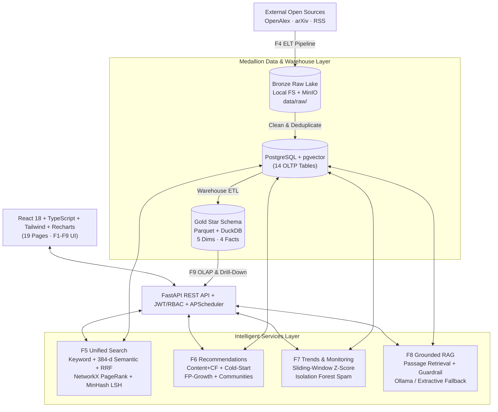
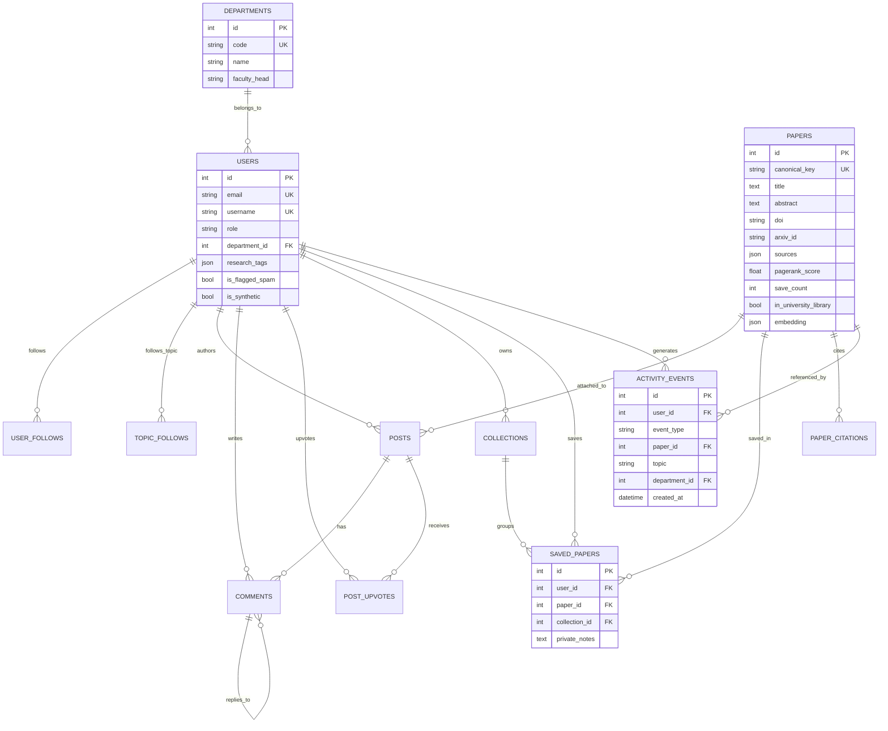
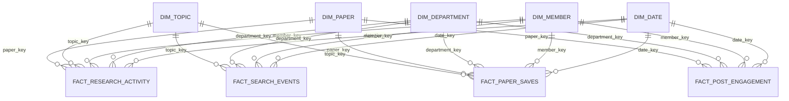
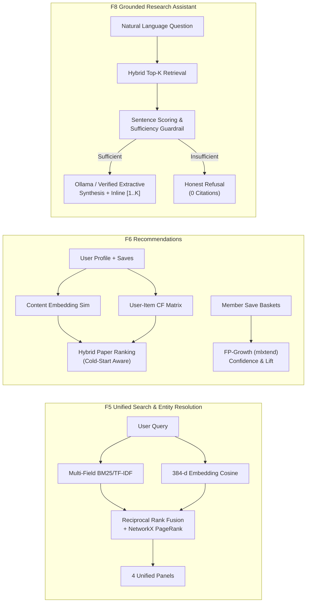

# Architecture, Database ER, Star Schema & ML Workflow Diagrams

High-resolution rendered PNG diagrams are also stored in [`documentation/diagrams/`](../diagrams/):
- [`system_architecture.png`](../diagrams/system_architecture.png)
- [`warehouse_star_schema.png`](../diagrams/warehouse_star_schema.png)
- [`ingestion_elt_pipeline.png`](../diagrams/ingestion_elt_pipeline.png)
- [`eval_search_comparison.png`](../diagrams/eval_search_comparison.png)
- [`eval_ml_benchmarks.png`](../diagrams/eval_ml_benchmarks.png)

---

## 1. System Architecture Diagram

---

## 2. Operational Database ER Diagram

---

## 3. Data Warehouse Kimball Star Schema

---

## 4. Machine Learning Workflows (F5, F6, F7, F8)

