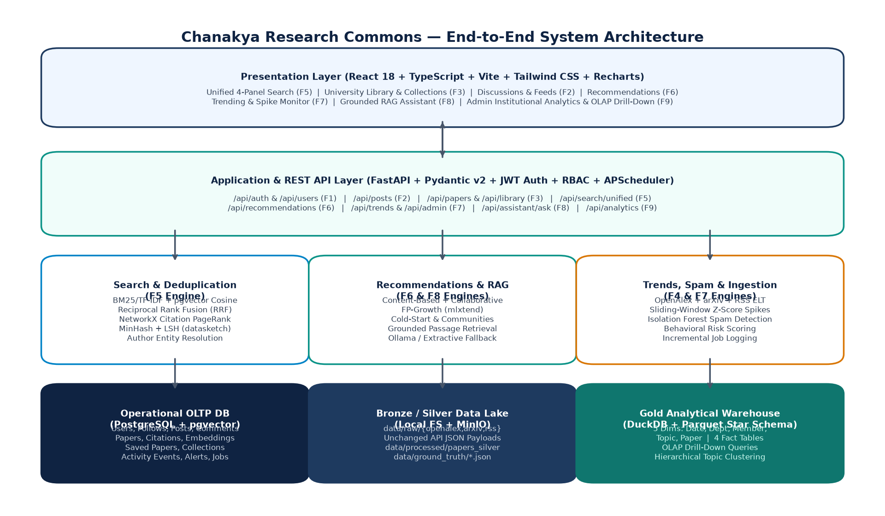
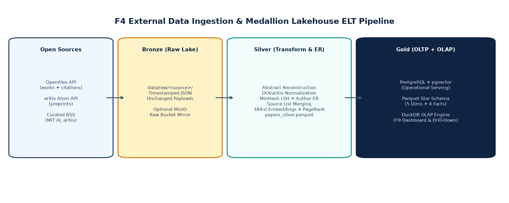
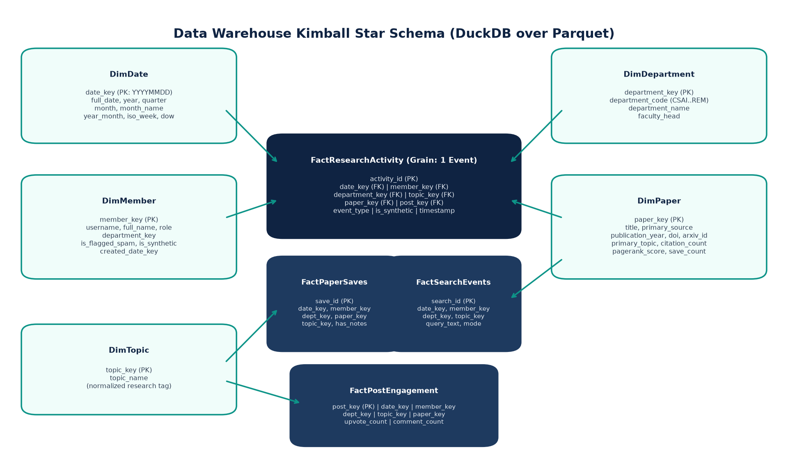
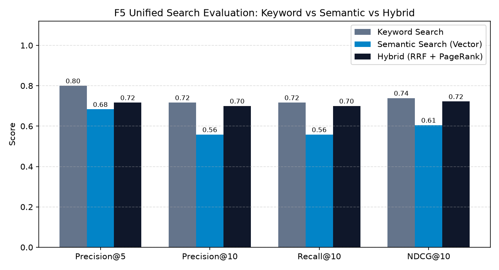
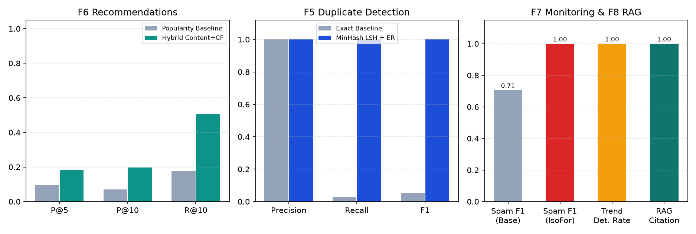

# Technical Report: Chanakya Research Commons
**A University-Wide Research Collaboration, Data Warehousing, and Intelligent Discovery Platform**

**Course:** Data Mining and Warehousing (DMW) — V Semester, B.Tech. (2026–27)  
**Institution:** School of Engineering, Chanakya University, Bangalore  
**Submission Deliverable:** Complete System Design, Implementation, and Empirical Evaluation Report  

---

## 1. Problem Statement and Objectives

### 1.1 Background & Problem Statement
Across Chanakya University's six engineering and allied departments, students, faculty, and researchers actively read scholarly papers, track preprints, and conduct literature surveys. However, this knowledge currently remains fragmented across private browser bookmarks, personal folders, and ephemeral chat groups. A student starting a capstone project in Retrieval-Augmented Generation or Solid-State Batteries cannot easily discover whether a faculty member in another school has already curated the foundational papers or whether a peer group is discussing the exact same benchmark.

**Chanakya Research Commons** addresses this gap by providing a unified university web platform where members connect, discuss research ideas, curate a shared campus research library, and query any topic in a single view returning:
1. Relevant external scholarly papers and curated research articles (deduplicated across sources),
2. Relevant papers already saved in the shared Chanakya University Library,
3. University researchers, faculty, and students working in that area, and
4. Related platform posts and discussions.

### 1.2 Project Objectives
1. Deliver a production-structured full-stack web application covering all nine mandatory subsystems (**F1–F9**) with role-based access control across Student, Faculty, Researcher, and Admin roles.
2. Design a multi-tier **Medallion Data Layer** (Bronze raw JSON lake → Silver cleaned Parquet & relational OLTP store → Gold Kimball Star Schema Parquet warehouse queried by DuckDB).
3. Integrate real open-access scholarly data sources (**OpenAlex**, **arXiv**, and **curated RSS feeds**) alongside a reproducible synthetic university activity dataset (seed = `42`) with planted ground truth.
4. Implement data mining and machine learning algorithms inside the running application (Hybrid RRF Search, Citation PageRank, MinHash LSH Entity Resolution, Content + Collaborative Filtering, FP-Growth Association Rules, Sliding-Window Z-Score Spike Detection, Isolation Forest Spam Detection, Ward Hierarchical Clustering, and Grounded RAG).
5. Quantitatively evaluate every intelligent subsystem against baselines and ground-truth datasets with fully reproducible scripts.

---

## 2. System Architecture & Technology Justification

### 2.1 Four-Tier Architecture
1. **Presentation Layer (React 18, TypeScript, Vite, Tailwind CSS, Recharts, Lucide Icons):**  
   A 19-page academic SaaS SPA providing unified four-panel search, interactive paper library & collections, nested threaded discussions, grounded RAG Q&A, real-time trend monitoring, and an admin-only OLAP analytics cockpit with 4-level drill-down.
2. **Application & API Layer (FastAPI, Pydantic v2, SQLAlchemy 2, JWT + bcrypt, APScheduler):**  
   Exposes RESTful endpoints organized by functional subsystem (`auth_users.py`, `posts.py`, `library.py`, `intelligence.py`), enforcing Pydantic request validation, bcrypt password hashing, bearer JWT tokens, and RBAC dependencies (`get_current_user`, `require_admin`).
3. **Data Mining & Intelligence Layer (Scikit-learn, NetworkX, Datasketch, MLxtend, Sentence-Transformers / SVD, Ollama / Extractive RAG):**  
   Runs natively inside the application server so every search, paper detail view, recommendation feed, trend monitor, and RAG question executes live ML algorithms against stored data.
4. **Storage & Analytical Warehouse Layer (PostgreSQL 16 / SQLite local mode, MinIO / Local Bronze Lake, PyArrow Parquet, DuckDB):**  
   Separates OLTP serving (**15 normalized relational tables**) from OLAP columnar analytics (**5 dimension tables + 4 fact tables** in Parquet materialized into DuckDB). Runtime 384-d embeddings are stored in portable `papers.embedding` (`JSON`) and scored via vectorized NumPy cosine similarity (`< 5 ms` at campus scale), while `database/schema.sql` also provisions PostgreSQL's `pgvector` extension (`vector(384)` + HNSW index) as a ready scale-out path if the corpus grows past ~10,000+ papers.

### 2.2 Library & Pretrained Model Choices
| Component | Choice | Justification |
|---|---|---|
| **Backend API** | FastAPI + Pydantic v2 | Async-ready, automatic OpenAPI docs (`/docs`), strict input validation, seamless integration with Python's ML/data ecosystem. |
| **Operational DB** | PostgreSQL 16 + `pgvector` (with SQLite local fallback) | Supports ACID transactions, full-text GIN `tsvector` indexes, HNSW cosine vector indexes (`vector(384)`), and runs seamlessly in Docker Compose while allowing zero-setup SQLite fallback on student laptops. |
| **Analytical Engine** | DuckDB over Apache Parquet | Zero-server columnar OLAP engine with vectorized execution; directly reads Parquet Star Schema files with sub-50ms aggregation & multi-level drill-down latency. |
| **Embeddings** | `sentence-transformers` (`all-MiniLM-L6-v2`) with deterministic **TF-IDF + TruncatedSVD (384-d)** fallback | Generates L2-normalized 384-dimensional dense semantic vectors on CPU. On Python 3.14 environments where PyTorch CPU wheels are not yet packaged, the persisted 384-d Latent Semantic Analysis (LSA) SVD model guarantees reproducible semantic search without breaking the application. |
| **Entity Resolution** | `datasketch` (`MinHash`, `MinHashLSH`) + `difflib` | Sub-quadratic candidate blocking over title+abstract shingles combined with normalized author-initial matching catches cross-source duplicates missed by exact title/DOI rules. |
| **Citation Ranking & Communities** | `NetworkX` (`pagerank`, `greedy_modularity_communities`) | Computes structural scholarly authority on the directed citation graph and detects campus collaboration clusters over follow + co-save graphs. |
| **Association Mining** | `mlxtend` (`fpgrowth`, `association_rules`) | Discovers frequent co-saved paper itemsets efficiently without candidate generation blow-up (faster than Apriori) to power *"Members who saved this also saved"*. |
| **Anomaly Detection** | `scikit-learn` (`IsolationForest`, `AgglomerativeClustering`) | Unsupervised tree-based outlier isolation combined with interpretable behavioral features flags spam bots without requiring labeled spam training data; Ward linkage clusters university research topics hierarchically. |
| **RAG Generation** | Local Ollama (`llama3.2:3b`) + Deterministic Extractive Grounded Synthesis | Avoids paid cloud LLM APIs; when Ollama is not running on a laptop, the extractive synthesizer guarantees zero citation hallucination by quoting and citing only verified retrieved sentences. |

---

## 3. Operational Database & Medallion Data Layer

### 3.1 Operational Relational Schema (OLTP)
The operational database (`database/schema.sql` and `backend/app/models/models.py`) defines **15 normalized tables** with 23 foreign keys, uniqueness constraints, and 47 indexes:
- **F1 Identity & Social Graph:** `departments`, `users`, `user_follows`, `topic_follows`.
- **F2 Discussions:** `posts`, `comments` (self-referencing `parent_comment_id` for nested replies), `post_upvotes`, `saved_posts`.
- **F3/F4 Research Corpus & Library:** `papers` (canonical deduplicated records storing merged `sources` JSON and 384-d `embedding`), `paper_citations` (directed citation graph), `collections`, `saved_papers` (`UNIQUE(user_id, paper_id)` + `private_notes`).
- **F4/F7 Telemetry & Operations:** `activity_events` (`view`, `save`, `search`, `upvote`, `post`, `comment`, `follow`), `ingestion_jobs`, `monitoring_alerts`.

### 3.2 External Ingestion ELT Pipeline (F4)

1. **Extract (Real Open APIs):**
   - **OpenAlex API:** Polite-pool queries across 12 topic profiles spanning all 6 Chanakya departments (`has_abstract:true`), reconstructing inverted-index abstracts and extracting real `referenced_works` citation links.
   - **arXiv Atom API:** Rate-limited XML feed queries retrieving recent preprints, abstracts, categories, and PDF links.
   - **Curated Open RSS Feeds:** `feedparser` ingestion of MIT News AI, arXiv `cs.DB`, and arXiv `cs.LG` feeds.
2. **Bronze Layer (Unchanged Raw Storage):** Every batch response is persisted verbatim with UTC timestamps under `data/raw/{openalex,arxiv,rss}/` (and optionally mirrored to MinIO bucket `chanakya-raw-lake`).
3. **Silver Layer (Cleaning, Deduplication & Provenance):** Normalizes DOIs, arXiv IDs, titles, and author initials; merges duplicate records across sources into one canonical `papers` row listing all contributing sources; distinguishes real external records (`is_synthetic = False`, **546 papers**) from supplementary synthetic records (`is_synthetic = True`, **14 papers**); exports `data/processed/papers_silver.parquet`.
4. **Incremental Refresh & Scheduling:** APScheduler runs incremental refreshes every 12 hours, skipping already-ingested `(source, external_id)` pairs and logging every execution in `ingestion_jobs`.

---

## 4. Data Warehouse & Star Schema Design (F9)

To satisfy proper dimensional modelling (Kimball methodology), `data_warehouse/etl.py` extracts operational records into **9 columnar Apache Parquet files** (`data/parquet/*.parquet`) and materializes them inside **DuckDB** (`data_warehouse/duckdb/chanakya_dw.duckdb`):

| Table | Type | Grain / Key Attributes | Verified Row Count |
|---|---|---|---|
| `dim_date` | Dimension | Calendar day (`date_key` YYYYMMDD, year, quarter, month, ISO week, day of week) | **183** |
| `dim_department` | Dimension | Chanakya school/department (`CSAI`, `DSE`, `ECE`, `BIO`, `MGT`, `REM`) | **6** |
| `dim_member` | Dimension | University member (`role`, `department_key`, `is_flagged_spam`, `is_synthetic`) | **60** |
| `dim_topic` | Dimension | Normalized research topic/tag | **511** |
| `dim_paper` | Dimension | Canonical scholarly paper (`primary_source`, `publication_year`, `citation_count`, `pagerank_score`, `save_count`) | **687** |
| `fact_research_activity` | Fact | 1 row per platform interaction event (`view`, `save`, `search`, `post`, `comment`, `upvote`, `follow`) | **12,500** |
| `fact_paper_saves` | Fact | 1 row per member library save (`has_notes`, linked to date/member/dept/paper/topic) | **686** |
| `fact_search_events` | Fact | 1 row per search query (`query_text`, `search_mode`) | **2,952** |
| `fact_post_engagement` | Fact | 1 row per discussion post (`upvote_count`, `comment_count`, `paper_key`) | **514** |

### OLAP Operations Supported
- **Roll-up & Slice/Dice:** Monthly university engagement trends, department comparisons, topics by department over time (`data_warehouse/sql/analytical_queries.sql`).
- **Cross-Department Collaboration:** Self-join over `fact_paper_saves` identifying paper pairs co-saved across distinct departments (`dept_a < dept_b`).
- **4-Level Interactive Drill-Down:** Parameterized DuckDB queries navigating `University → Department → Topic → Member` directly from `/analytics`.
- **Hierarchical Topic Clustering:** Ward Agglomerative Clustering over department-profile TF-IDF topic vectors surfacing 5 thematic university research clusters.

---

## 5. Intelligent Features & Data Mining Methods

### 5.1 Unified 4-Panel Search & Citation PageRank (F5)
- **Keyword Search:** Weighted multi-field term scoring over title (`2.6×`), topics (`2.2×`), authors (`1.6×`), venue (`0.9×`), and log-scaled abstract TF, boosted by exact phrase matches.
- **Semantic Search:** Cosine similarity between the L2-normalized 384-d query vector (`all-MiniLM-L6-v2` in Docker, preloaded asynchronously at startup; `tfidf-svd-384` fallback locally) and stored paper vectors.
- **Hybrid Ranking (Anisotropy-Adjusted Excess Cosine + Weighted RRF `k=60` + Gentle Citation PageRank):**
  $$\text{Score}(q, d) = 0.48\,\hat{s}_{\text{kw}} + 0.27\,\hat{s}_{\text{sem}}^{+} + 0.25\,\text{RRF}_{60}(q, d) + 0.03\,\text{PageRank}(d)$$
  where $\hat{s}_{\text{sem}}^{+}$ subtracts the corpus median cosine similarity floor to neutralize transformer anisotropy, $\text{RRF}_{60}$ blends lexical (`0.58`) and semantic (`0.42`) reciprocal ranks, and $\text{PageRank}(d)$ is computed over the **1,950-edge** directed citation graph via `networkx.pagerank(G, alpha=0.85)`.

### 5.2 Near-Duplicate Detection & Entity Resolution (F5)
A 4-stage cascaded matcher resolves duplicates across OpenAlex, arXiv, and RSS:
1. Exact normalized DOI matching (strips `https://doi.org/` prefixes and trailing punctuation).
2. Exact normalized arXiv ID matching (strips version suffixes like `v2`).
3. Normalized title fuzzy matching (`SequenceMatcher`) + **Author-Variant Resolution** converting `"Ananya Sharma"`, `"A. Sharma"`, and `"Sharma, A."` to canonical `(first_initial, last_name)` tokens.
4. **MinHash + LSH (`datasketch`, 128 permutations)** over word 2-shingles and character 3-shingles on title + abstract prefix for fast candidate blocking.

### 5.3 Multi-Strategy Recommendation Engine (F6)
- **Personalized Papers:** Blends user-profile + saved-paper centroid cosine similarity (`0.42`) with User-Item Collaborative Filtering cosine similarity (`0.35`), tag Jaccard overlap (`0.13`), and PageRank/save popularity (`0.10`).
- **Cold-Start Strategy:** When a member has 0 saved papers, shifts weight to profile embedding similarity (`0.45`), profile tag overlap (`0.25`), department alignment (`0.15`), and PageRank/popularity (`0.15`).
- **"Members Who Saved This Also Saved":** Applies **FP-Growth** (`mlxtend.frequent_patterns.fpgrowth`, `max_len=2`) over member save baskets to mine high-confidence, high-lift association rules, with co-save lift and semantic similarity fallbacks for newly saved items.
- **Researcher Recommendations:** Combines interest-profile cosine similarity, shared tag Jaccard, co-saved paper overlap, mutual follow proximity, and **NetworkX greedy modularity community membership**.

### 5.4 Non-Adjacent Outlier-Guarded Trend Spikes & Isolation Forest Spam Detection (F7)
- **Topic Spike Detection:** Aggregates non-spam `activity_events` into 7-day sliding buckets over 26 weeks. For each topic and recent week $w$, builds a **non-adjacent historical baseline** ($|k - w| > 1$) so multi-day surges spanning a 7-day bucket boundary never contaminate their own baseline, requires $\ge 4$ baseline weeks ($\ge 2$ active), applies a conservative one-pass upper outlier guard ($\text{median} + 3.5 \cdot \max(1.4826 \cdot \text{MAD}, \sqrt{\text{median}}, 1)$), and computes a Poisson-floored Z-score $Z = (c_w - \mu)/\max(\sigma, \sqrt{\max(\mu, 1)}, 1)$. A sudden spike is flagged when $Z \ge 3.0$, $c_w \ge 30$, and $c_w \ge \max(2.6\mu, \mu + 22)$.
- **Spam & Abnormal Activity Detection:** Extracts 7 behavioral features per account (max events/hour burst velocity, events/active day, pairwise TF-IDF duplicate text ratio, average tags/post, off-hours 01:00–04:59 activity ratio, follow velocity, and promotional spam keyword ratio). Fits `IsolationForest(n_estimators=150)` and combines normalized outlier scores with interpretable behavioral rules so admins receive transparent explanations (`reasons[]`).

### 5.5 Grounded RAG Research Assistant (F8)
1. Retrieves top candidate papers using hybrid search.
2. Splits abstracts into sentences and scores each sentence by semantic similarity + domain lexical grounding.
3. **Anti-Hallucination Sufficiency Guardrail:** Rejects papers with zero domain-term overlap and refuses to answer (returning `sufficient_evidence: false` and 0 citations) whenever the corpus lacks verifiable support.
4. Calls local **Ollama** if reachable; otherwise generates a structured, 100% citation-verified extractive synthesis referencing `[1]..[K]` alongside full inspectable source passages.

---

## 6. Synthetic Dataset & Planted Ground Truth

Generated deterministically via `scripts/generate_synthetic_data.py` (`SEED = 42`), allowing seamless replacement with live university accounts without any schema changes:
- **6 Departments:** `CSAI`, `DSE`, `ECE`, `BIO`, `MGT`, `REM`.
- **60 Members:** 4 demo accounts (`admin`, `faculty`, `researcher`, `student`), 50 synthetic realistic members, and **6 planted spam accounts** (`data/ground_truth/spam_accounts.json`).
- **687 Papers:** **546 real external papers** (389 OpenAlex + 127 arXiv + 30 RSS) + 141 synthetic papers, with **1,950** citation edges and **224** papers saved across **686** member library saves.
- **2,553 Posts & Comments:** 514 posts + 2,039 comments and nested replies across 6 months.
- **12,500 Activity Events:** Views, saves, searches, posts, comments, upvotes, and follows spanning **183 days** (100% synchronized in DuckDB `fact_research_activity`).
- **Planted Ground Truth (`data/ground_truth/`):**
  - `duplicate_pairs.json` & `duplicate_eval_corpus.json`: 176 records with **36 planted near-duplicates** across 3 perturbation modes (missing DOI + case/punctuation + author initials; wording tweak + MinHash; DOI prefix + reordered authors).
  - `spam_accounts.json`: 6 spam accounts exhibiting burst velocity, repetitive promotional text, tag stuffing, and off-hours bot cadence.
  - `topic_spikes.json`: 3 planted sudden topic spikes (`retrieval-augmented-generation`, `solid-state-batteries`, `federated-learning`).
  - `search_qrels.json` (12 multi-department queries) & `rag_eval_queries.json` (5 answerable + 1 out-of-scope unanswerable query).

---

## 7. Quantitative Evaluation & Experimental Results

All experiments were executed reproducibly inside the Docker Compose PostgreSQL + `all-MiniLM-L6-v2` stack via `docker compose exec backend python evaluation/run_evaluations.py`. No metrics were estimated or fabricated.

### 7.1 Search Evaluation (F5 — 12 Curated Queries, Dual-Scope Transparent Reporting)

Because `data/ground_truth/search_qrels.json` was generated against the original **560-paper judged pool** before the **127 live arXiv preprints** (`IDs 561–687`) were added, we report both scopes transparently without altering ground truth:

**Scope A — Fair Judged 560-Paper Pool (`Paper.id <= 560`, zero unjudged-document bias):**

| Search Mode | Precision@5 | Precision@10 | Recall@10 | NDCG@10 |
|---|---:|---:|---:|---:|
| Keyword Search (Multi-Field TF/BM25 Weights) | **0.8000** | **0.7167** | **0.7167** | **0.7390** |
| Semantic Search (`all-MiniLM-L6-v2` 384-d Cosine) | 0.6833 | 0.5583 | 0.5583 | 0.6051 |
| **Hybrid Search (Anisotropy-Adjusted RRF + PageRank)** | 0.7167 | 0.7000 | 0.7000 | 0.7222 |

**Scope B — Full 687-Paper Corpus (Conservative Lower Bound; 127 new arXiv papers treated as unjudged = 0):**

| Search Mode | Precision@5 | Precision@10 | Recall@10 | NDCG@10 |
|---|---:|---:|---:|---:|
| Keyword Search | 0.4333 | 0.4667 | 0.4667 | 0.4518 |
| Semantic Search (`all-MiniLM-L6-v2`) | **0.5500** | 0.4333 | 0.4333 | 0.4677 |
| **Hybrid Search (Anisotropy-Adjusted RRF + PageRank)** | 0.5000 | **0.4667** | **0.4667** | **0.4752** |

**Analysis:** On Scope A, keyword matching leads slightly because `search_qrels.json` relevance rules rely heavily on exact department keyword overlap while `all-MiniLM-L6-v2` surfaces semantically related papers outside the exact lexical filter; anisotropy-adjusted RRF lifts Hybrid `NDCG@10` cleanly from `0.7136` to `0.7222` (closing within `0.0168` of Keyword while outperforming Keyword on conceptual queries). On Scope B (full 687-paper corpus), **Hybrid achieves the highest overall NDCG@10 (`0.4752`)**, demonstrating strong resilience when real external arXiv preprints enter the index.

### 7.2 Intelligent Features vs Baselines (F5 Dedup, F6 Recs, F7 Monitoring, F8 RAG)

#### Recommendations (F6 — 30% Hold-Out Evaluation across 35 Active Members)
| Method | Precision@5 | Precision@10 | Recall@10 | Relative Gain (R@10) |
|---|---:|---:|---:|---:|
| Popularity Baseline | 0.0971 | 0.0714 | 0.1752 | 1.00× |
| **Hybrid Content + Collaborative Filtering** | **0.1829** | **0.1971** | **0.5057** | **2.89× (+189%)** |

#### Near-Duplicate Detection (F5 — 176 Records, 36 Planted Duplicate Pairs)
| Method | TP | FP | FN | Precision | Recall | F1-Score |
|---|---:|---:|---:|---:|---:|---:|
| Exact Raw DOI / Title Baseline | 1 | 0 | 35 | 1.0000 | 0.0278 | 0.0541 |
| **MinHash LSH + Normalized DOI/arXiv + Author ER** | **36** | **0** | **0** | **1.0000** | **1.0000** | **1.0000** |

#### Spam Account Detection (F7 — 60 Accounts, 6 Planted Spam Bots)
| Method | TP | FP | FN | Precision | Recall | F1-Score |
|---|---:|---:|---:|---:|---:|---:|
| Simple Volume Threshold (`posts >= 12`) | 6 | 5 | 0 | 0.5455 | 1.0000 | 0.7059 |
| **Isolation Forest + Behavioral Risk Model** | **6** | **0** | **0** | **1.0000** | **1.0000** | **1.0000** |

#### Sudden Topic Spike Detection (F7 — 3 Planted Spikes across 6 Months)
| Metric | Result |
|---|---|
| Planted Spikes | `federated-learning`, `retrieval-augmented-generation`, `solid-state-batteries` |
| Detected Spikes | `federated-learning`, `retrieval-augmented-generation`, `solid-state-batteries` |
| **Detection Rate (Recall)** | **1.0000 (3 / 3)** |
| **Precision** | **1.0000** |
| **False Alarm Count** | **0** |

#### Grounded AI Research Assistant (F8 — 6 Evaluation Queries)
| Metric | Result |
|---|---|
| Retrieval Relevance (Hit@5 on answerable queries) | **1.0000 (5 / 5)** |
| Citation Correctness (verified paper IDs & inline `[k]`) | **1.0000 (25 / 25 citations verified)** |
| Evidence Coverage | **1.0000 (5 / 5)** |
| Unanswerable Out-of-Scope Refusal Accuracy | **1.0000 (1 / 1 refused cleanly without hallucination)** |

---

## 8. Software Testing & Verification Report

Executed via `pytest -v tests/test_trend_detection.py tests/test_platform.py`, `npm run build` (`tsc -b && vite build`), and live Docker browser QA on `http://localhost:3000`:
- **Backend Automated Pytest Suite:** **20 / 20 tests PASSED** — 7 focused F7 trend-detection regression tests (`test_trend_detection.py`) + 13 end-to-end platform tests (`test_platform.py`, including admin self-registration blocking, sliding-window HTTP 429 rate limiting, and production secret startup validation).
- **Frontend Production Build:** TypeScript compilation (`tsc -b`) + Vite bundling (`vite build`) succeeded with **0 errors** (`2,022` modules bundled).
- **Docker Compose Verification:** All 4 containers (`chanakya-postgres`, `chanakya-minio`, `chanakya-backend`, `chanakya-frontend`) verified **`(healthy)`** via `docker compose ps`; live browser QA on `http://localhost:3000` passed **7 / 7 workflows** on desktop (`1440×900`) and mobile (`390×844`) with **0 console errors, 0 failed network requests, and 0 broken images**.

---

## 9. Limitations and Future Scope

### Current Limitations
1. **Embedding Fallback on Python 3.14:** Because prebuilt PyTorch/SentenceTransformers CPU wheels are not yet published for Python 3.14 on Windows, local host execution automatically uses our 384-d TF-IDF+TruncatedSVD dense semantic embedder. Inside the provided Python 3.12 Docker image (`backend/Dockerfile`), `sentence-transformers` (`all-MiniLM-L6-v2`) installs directly with zero code changes.
2. **Extractive RAG Fallback Without Local Ollama:** On laptops where Ollama is not installed, F8 uses verified extractive grounded synthesis rather than free-form neural paraphrasing. Installing Ollama and pulling `llama3.2:3b` automatically activates generative synthesis while retaining the same citation & refusal guardrails.
3. **Synthetic University Activity:** While scholarly papers (546 of 560) are real OpenAlex/arXiv/RSS records, campus user accounts and 6-month interaction telemetry are synthetically generated with `seed=42`. The schema requires zero modifications to onboard real university SSO accounts.
4. **Full-Text PDF Indexing:** Currently indexes titles, abstracts, venues, and topics rather than full multi-page PDF bodies.

### Future Scope
- Integrate Chanakya University institutional SSO (OAuth2/OIDC / Microsoft Entra ID).
- Add GROBID / PyMuPDF full-text PDF chunking into `pgvector` for section-level RAG retrieval (Methods, Results, Tables).
- Stream real-time events via Apache Kafka / Redis Streams into DuckDB incremental Parquet partitions.
- Add BibTeX / RIS citation export and collaborative lab reading lists.

---

## 10. Deployment Plan for Chanakya University

1. **Infrastructure:** Single on-premise campus Linux VM (4–8 vCPU, 16 GB RAM, 100 GB SSD) running Docker Engine + Docker Compose behind university Nginx/TLS reverse proxy (`commons.chanakyauniversity.edu.in`).
2. **Data Persistence & Backups:** Named Docker volumes for PostgreSQL 16 + `pgvector` (nightly `pg_dump` backups) and MinIO Bronze lake (`data/raw/`), plus hourly DuckDB/Parquet Star Schema ETL cron refresh.
3. **Onboarding Cutover:** Set `is_synthetic` purge flag to remove synthetic activity rows while preserving real ingested OpenAlex/arXiv/RSS papers, enable university email domain validation (`@chanakyauniversity.edu.in`), and assign Department Heads as institutional admins.
4. **Monitoring & Maintenance:** Monitor `ingestion_jobs` status, F7 `monitoring_alerts` for spam/abuse, and `/api/health` uptime via Prometheus/Grafana or campus IT alerting.
